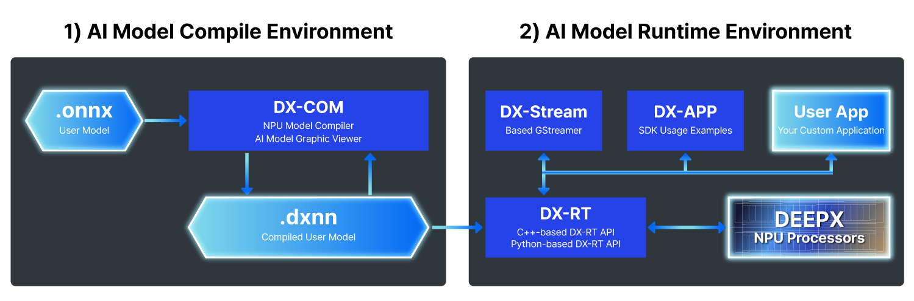

<div align="center">

# DX-RT

**Run compiled `.dxnn` models on DEEPX NPUs from C++ or Python.**

[](https://github.com/DEEPX-AI/dx_rt/releases)
[](https://developer.deepx.ai/tech-docs/DXNN-SDK/DX-RT/DXNN_Runtime_Overview/)

[What You Need](#what-you-need) · [Quick Start](#quick-start) · [Run from Python](#run-from-python) · [Run from C++](#run-from-c)

</div>

<div align="center">
  <picture>
    <source media="(prefers-color-scheme: dark)" srcset="./img/dxnn_sdk_illustration_simple-dark.png">
    
  </picture>
</div>

DX-RT (DXNN® Runtime) is the runtime of the DXNN® SDK. It loads a `.dxnn` model compiled by
[DX-COM](https://github.com/DEEPX-AI/dx-compiler) and runs it on a DEEPX NPU through the NPU driver and
firmware, handling model loading, I/O buffers, inference scheduling and device monitoring. It is part of
[DX-Runtime](https://github.com/DEEPX-AI/dx-runtime), the target-side bundle of
[DX-AllSuite](https://github.com/DEEPX-AI/dx-all-suite), which keeps the SDK component versions aligned.

- **C++ and Python APIs** — synchronous and asynchronous inference, batch and multi-input models, from `#include <dxrt/dxrt_cxx_api.h>` or `import dx_engine`.
- **Command-line tools** — `dxrun` to run and benchmark a model, `dxparse` to inspect it, `dxcli` to manage devices and firmware, `dxtop` to monitor the NPU.
- **Prebuilt packages** — `libdxrt-bin` for amd64 and arm64 with libraries, headers, CLI tools and Python wheels; no on-target compilation.

## What You Need

| | |
|---|---|
| **Arch** | x86_64, aarch64 |
| **OS** | Ubuntu 20.04 / 22.04 / 24.04 / 26.04 LTS, Debian 12 / 13, Windows 10 22H2 or later (x64) |
| **Memory** | 8 GB RAM (16 GB recommended), 4 GB free disk |
| **Python** | 3.8–3.14 (for `dx_engine`) |
| **NPU** | DX-M1, DX-M1M or DX-H1 Quattro, in an M.2 or PCIe slot (Windows: also USB4 / Thunderbolt with PCIe tunneling) |
| **Driver (Linux)** | NPU driver v2.7.0+, PCIe driver v2.7.0+ |
| **Driver (Windows)** | NPU driver v1.8.0+, PCIe driver v2.0.1+ |
| **Firmware** | v2.7.6+ |
| **Models** | `.dxnn` files from DX-COM, including format v9 from DX-COM v2.5.0 |

## Quick Start

Install the NPU driver, firmware and DX-RT in one step (Ubuntu / Debian, needs `sudo`), then reboot to load the driver:

```bash
curl -fsSL https://raw.githubusercontent.com/DEEPX-AI/dx-runtime/main/oneline-install.sh | sh
sudo reboot
```

Check the NPU, download ResNet-50 from DX-ModelZoo, and run it (prints latency and FPS):

```bash
dxcli -s
curl -fLO https://sdk.deepx.ai/modelzoo/q-lite-dxnn/latest/resnet50_224x224.dxnn
dxrun -m resnet50_224x224.dxnn -l 100
```

**Success:** `dxcli -s` lists the device with its driver and firmware versions (`x.y.z` and `<build>` stand for your installed versions):

```text
DXRT vx.y.z (build: <build>)
=======================================================
 * Device 0: M1, Accelerator type
---------------------   Version   ---------------------
 * RT Driver version   : vx.y.z (build: <build>)
 * PCIe Driver version : vx.y.z
-------------------------------------------------------
 * FW version          : vx.y.z (build: <build>)
--------------------- Device Info ---------------------
 * Memory : LPDDR5 5600 Mbps, 3.92GiB
 * Board  : M.2, Rev 1.0
 * PCIe   : Gen3 X4 [02:00:00]
...
```

**If it fails:**

| Symptom | What to do |
|---|---|
| `dxcli: command not found` | The install did not finish. Run the installer again and check its output for errors |
| `dxcli -s` shows no device | Run `lspci -d 1ff4:`. If nothing is listed, power off, reseat the NPU module and boot again |
| The device is listed by `lspci` but not by `dxcli -s` | Run `lsmod` and look for `dxrt_driver` and `dx_dma`. If they are missing, reboot, or reinstall the driver |
| Driver or firmware version is below [What You Need](#what-you-need) | Run the installer again to update them |

The installer comes from [dx-runtime](https://github.com/DEEPX-AI/dx-runtime), which bundles the driver,
firmware and DX-RT. Pin versions with `DX_RT_VERSION`, `DX_DRIVER_VERSION` and `DX_FW_VERSION`; remove
everything with `oneline-uninstall.sh` from the same URL.

## Run from Python

```python
import numpy as np
from dx_engine import InferenceEngine

ie = InferenceEngine("resnet50_224x224.dxnn")
input_data = [np.zeros(ie.get_input_size(), dtype=np.uint8)]   # replace with your preprocessed image
outputs = ie.run(input_data)
for i, out in enumerate(outputs):
    print(i, out.shape, out.dtype)
```

The package stages the `dx_engine` wheels in `/usr/share/libdxrt-bin/python/` but does not install them.
Install the wheel for your Python version first, preferably in a virtualenv:

```bash
PYTAG=cp$(python -c 'import sys;print(f"{sys.version_info[0]}{sys.version_info[1]}")')
pip install /usr/share/libdxrt-bin/python/dx_engine-*-${PYTAG}-${PYTAG}-*.whl
python -c "import dx_engine; print(dx_engine.__version__)"
```

Asynchronous inference, batches and multi-input models → [Python Tutorials](https://developer.deepx.ai/tech-docs/DXNN-SDK/DX-RT/09_02_Python_Tutorials/)

## Run from C++

```cpp
#include <dxrt/dxrt_cxx_api.h>

int main()
{
    dxrt::InferenceEngine ie("resnet50_224x224.dxnn");
    std::vector<uint8_t> input(ie.GetInputSize(), 0);   // replace with your preprocessed image
    auto outputs = ie.Run(input.data());
    return 0;
}
```

`dxrt_cxx_api.h` is a single C++14 header for the full API. Code that includes the older `dxrt_api.h`
still builds, but do not include both in one source file.
Project setup and more examples → [C++ Tutorials](https://developer.deepx.ai/tech-docs/DXNN-SDK/DX-RT/09_01_C++_Tutorials/) · [`examples/`](./examples)

## Command-Line Tools

| Tool | What it does |
|---|---|
| `dxrun` | Runs a model, measures latency and FPS; `--max-throughput` finds the best I/O buffer count |
| `dxparse` | Shows a model's structure, input/output tensors and metadata |
| `dxcli` | Device status (`-s`), reset and firmware update |
| `dxtop` | Real-time NPU utilization, temperature and memory monitor |
| `dxbenchmark` | Benchmarks every model in a directory and writes an HTML report |

The older names `run_model`, `parse_model` and `dxrt-cli` still work.
Options → [Command Line Interface](https://developer.deepx.ai/tech-docs/DXNN-SDK/DX-RT/Command_Line_Interface/)

<details>
<summary><b>Install from This Repository: prebuilt package, build from source</b></summary>

**Prebuilt package.** Install the `.deb` that matches `dpkg --print-architecture`. The NPU driver and
firmware are installed separately (the one-line installer above does both).

```bash
sudo dpkg -i release/latest/libdxrt-bin_*_$(dpkg --print-architecture).deb   # run in dx_rt/
sudo apt --fix-broken install                              # only if dpkg reports unmet dependencies
ldconfig -p | grep libdxrt                                 # lists libdxrt.so.3; if empty, run: sudo ldconfig
```

The package does not install `dx_engine`; install its wheel as shown in [Run from Python](#run-from-python).

Uninstall with `sudo dpkg --purge libdxrt-bin`.

**Build from source.** For developers who change DX-RT itself:

```bash
./install.sh --all                                 # build dependencies and ONNX Runtime
./build.sh --clean && ./build.sh --install /usr/local
./build.sh --arch aarch64                          # cross-compile for aarch64
```

Build options are in `cmake/dxrt.cfg.cmake` (`USE_ORT`, `USE_PYTHON`, `USE_SERVICE`). With `USE_SERVICE=ON`
(default), register the `dxrtd` service for multi-process inference, then verify the setup:

```bash
sudo cp ./service/dxrt.service /etc/systemd/system
sudo systemctl start dxrt.service
./SanityCheck.sh
```

Details → [Installation on Linux](https://developer.deepx.ai/tech-docs/DXNN-SDK/DX-RT/Installation_on_Linux/)

</details>

<details>
<summary><b>Install on Windows</b></summary>

On Windows 10 22H2 or later (x64), install the DEEPX SDK installer for your NPU from DEEPX Software
Download (requires .NET Desktop Runtime 10 x64). It provides the driver and a prebuilt runtime; open a new
terminal and run `dxcli -s` to verify. The NPU can also be connected over USB4 / Thunderbolt with PCIe
tunneling; regular USB 3.x ports are not supported.

Building from source with Visual Studio 2022 → [Installation on Windows](https://developer.deepx.ai/tech-docs/DXNN-SDK/DX-RT/Installation_on_Windows/)

</details>

## Documentation & Support

- Guides, API reference and tutorials: **[DX-RT Tech Docs](https://developer.deepx.ai/tech-docs/DXNN-SDK/DX-RT/DXNN_Runtime_Overview/)** · [Release Notes](./RELEASE_NOTES.md)
- For technical questions, please ask in the DEEPX Developer Community: https://community.deepx.ai/c/support/5

## License

See [LICENSE](./LICENSE) for terms of use. Third-party components are listed in [NOTICE.md](./NOTICE.md).

Copyright © DEEPX Co., Ltd.