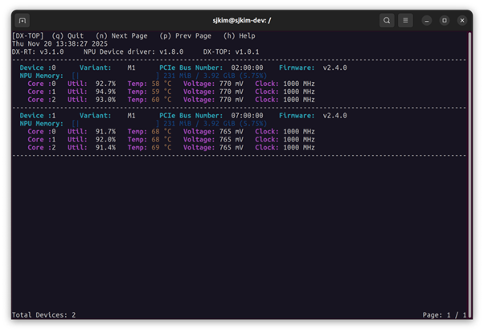

This chapter introduces the **DX-RT** command-line tools for model inspection, inference testing, and device management. These tools allow developers to validate models, measure performance, and control hardware directly from the terminal.  

These utilities are essential for validating model compilation, tuning inference performance, and maintaining the health and configuration of the underlying NPU hardware.

---

## Legacy Command Aliases

The legacy command names from earlier releases are preserved as aliases and continue to work.

| New | Legacy alias |
|---|---|
| `dxparse` | `parse_model` |
| `dxrun` | `run_model` |
| `dxcli` | `dxrt-cli` |

---

## Parse Model

This tool parses a compiled `.dxnn` model file and displays detailed information such as model structure, input/output tensors, and metadata.  

**Source**  
```
cli/dxparse.cpp
```

**Usage**  
```
dxparse -m <model.dxnn>
```

**Option**  
```
  -m, --model FILE    model path (required)
  -v, --verbose       show detailed task dependencies and memory usage
  -o, --output FILE   save the raw console output to a file (without color codes)
  -j, --json          extract JSON binary data (graph_info, rmap_info) to files
  -h, --help          show this help message
```

**Example**  
```
$./dxparse -m model.dxnn
```

---

## Run Model

This tool executes a compiled model to verify basic functionality, measure inference time, and optionally perform repeated runs for stress testing.

By default, `dxrun` measures performance in a **fixed buffer-count environment**: the I/O buffer count stays at a single value (the default `6`, or whatever is given to `--buffer-count <N>`) for the whole run, so the reported FPS/latency reflects only that one configuration.

To find the **maximum throughput** across different buffer counts, use `--max-throughput`. In this mode `dxrun` sweeps buffer counts upward (default range `3-100`, or the range given to `--buffer-count <low>-<high>`), measures each candidate for `--probe-time` seconds (after waiting for the NPU to cool below `--cool-down-temp`), and recommends the smallest buffer count whose FPS is within `--sweep-tolerance` of the peak. Add `-l` or `-t` to benchmark at the recommended buffer count after the sweep.

**Source**  
```
cli/dxrun.cpp
```

**Usage**  
```
dxrun -m <model.dxnn> [-l <number of loops>] [-t <seconds>] [-d <devices>] [--use-ort] [--profiler] [--buffer-count <N>]
dxrun -m <model.dxnn> --max-throughput [--buffer-count <low>-<high>] [--probe-time <seconds>] [--sweep-tolerance <percent>] [--cool-down-temp <celsius>] [-l <number of loops> | -t <seconds>]
```

**Option**  
```
  -m, --model arg            Model file (.dxnn)
  -b, --benchmark            Perform a benchmark test at a fixed
                             --buffer-count (default mode if --single, --fps
                             > 0, or --max-throughput is not specified)
  -s, --single               Perform a single run test (sequential
                             single-input inference on a single core)
  -v, --verbose              Shows NPU Processing Time, Queue Wait Time, E2E
                             Response Time, and Latency
  -n, --npu arg              NPU bounding
                             0: NPU_ALL
                             1: NPU_0
                             2: NPU_1
                             3: NPU_2
                             4: NPU_0/1
                             5: NPU_1/2
                             6: NPU_0/2 (default: 0)
  -l, --loops arg            Number of inference loops to perform (default:
                             30)
  -t, --time arg             Duration of inference in seconds (benchmark and
                             target-fps mode, overrides --loops) (default:
                             0)
  -w, --warmup-runs arg      Number of warmup runs before actual measurement
                             (default: 0)
  -d, --devices arg          Specify target NPU devices.
                             Examples:
                             'all' (default): Use all available/bound NPUs
                             '0': Use NPU0 only
                             '0,1,2': Use NPU0, NPU1, and NPU2
                             'count:N': Use the first N NPUs
                             (e.g., 'count:2' for NPU0, NPU1) (default: all)
  -f, --fps arg              Target FPS for TARGET_FPS_MODE (enabled if > 0
                             and --single is not set) (default: 0)
      --use-ort              Enable ONNX Runtime for CPU tasks in the model
                             graph
                             If disabled, only NPU tasks operate
      --profiler             Enable profiler
      --accel-nfh            Enable NFH (transpose) acceleration
                             (if available)
      --accel-cpu            Enable CPU op acceleration (OpenVINO/XNNPACK)
                             (if available)
      --buffer-count arg     I/O buffer count: a single number, or a range
                             such as 3-16 when used with --max-throughput
                             (range defaults to 3-100) (default: 6)
      --max-throughput       Search buffer counts for peak throughput and
                             recommend one. Give --buffer-count a range
                             (e.g. 3-16) to measure the full range; without
                             a range, detect the peak within 3-100. Add -l
                             or -t to benchmark at the recommended count
                             afterward. Mutually exclusive with --single and
                             --fps.
      --probe-time arg       Seconds to measure each candidate buffer count
                             (default: 2.0)
      --sweep-tolerance arg  FPS difference (%) treated as noise: smaller
                             gains do not extend the sweep, and the smallest
                             buffer count within this of the peak is
                             recommended (default: 1.0)
      --cool-down-temp arg   Before each max-throughput measurement, wait
                             until the NPU temperature ('C) drops below
                             this value; the sweep fails if it does not
                             within 300 seconds (default: 45)
  -h, --help                 Print usage
```

**Examples**  

Basic inference with 100 loops:
```
dxrun -m /.../model.dxnn -l 100
```

Enable profiler to collect detailed timing data:
```
dxrun -m model.dxnn --profiler -l 50
```
This generates a `profiler.json` file in the working directory containing detailed performance metrics.

Measure performance at a fixed buffer count:
```
dxrun -m model.dxnn --buffer-count 8 -l 100
```
The buffer count is held at `8` for the entire run, so the result represents that single configuration only. Adjust the number of input/output buffers (range: 1-100) to balance memory usage and inference throughput. Higher buffer counts can improve performance in pipelined scenarios. To compare multiple buffer counts automatically, use `--max-throughput` with a `--buffer-count <low>-<high>` range instead.

Combined options with profiling and custom buffer count:
```
dxrun -m model.dxnn --profiler --buffer-count 10 -l 200 -v
```

Benchmark mode with profiling enabled:
```
dxrun -m model.dxnn --benchmark --profiler -t 60
```
Run benchmark for 60 seconds with profiling enabled to analyze performance bottlenecks.

Auto-tune the buffer count for maximum throughput (default search range 3-100):
```
dxrun -m model.dxnn --max-throughput
```
Each buffer count is measured 3 times for `--probe-time` seconds, each with a dedicated engine, and the FPS is averaged. The sweep starts at 3 and stops when FPS stays 3% or more below the peak for 2 consecutive rounds, when FPS does not improve by more than `--sweep-tolerance` for 3 consecutive rounds, or at 100. It then prints a result table and the recommended buffer count.

Measure every buffer count in a specific range with a custom probe duration:
```
dxrun -m model.dxnn --max-throughput --buffer-count 3-16 --probe-time 3
```
With an explicit range, early stopping is disabled and every buffer count from 3 to 16 is measured.

Wait for the NPU to cool down before each measurement:
```
dxrun -m model.dxnn --max-throughput --cool-down-temp 50
```
Before every measurement, `dxrun` reads the highest temperature across all NPU devices and channels once per second and waits until it drops below `--cool-down-temp` (default `45`'C), so thermal throttling from a previous round does not skew the result. Each wait is logged as `[INFO] NPU temperature ...`. If the temperature does not drop below the target within 300 seconds, the sweep is invalidated, no buffer count is recommended, and `dxrun` exits with an error.

Benchmark at the recommended buffer count after the sweep:
```
dxrun -m model.dxnn --max-throughput -t 30
```
Without `-l` or `-t`, `dxrun` only reports the recommendation and does not run a final benchmark.

!!! note "NOTE"
    `--buffer-count` takes either a single value (e.g. `6`) or a range (e.g. `3-16`). A range is only
    valid together with `--max-throughput`; combining `--max-throughput` with a single value, or using
    a range without `--max-throughput`, is rejected with an error. `--max-throughput` cannot be
    combined with `--single` or `--fps`. `--cool-down-temp` is only valid together with
    `--max-throughput`.

!!! warning "WARNING"
    If a critical runtime event occurs during the sweep, no buffer count is recommended and `dxrun`
    exits with an error. An NPU memory overflow terminates `dxrun` immediately; if it occurs at large
    buffer counts, lower the upper bound with `--buffer-count <low>-<high>`.

**Output**

By default, `dxrun` prints only the FPS. With `-v`, it also prints the timing metrics below (averages over all completed inputs, or the last input in `--single` mode).

```
=====================================================================================================================================
* Benchmark Result (100 inputs)
  - NPU Processing Time Average : 2.841 ms   (Actual NPU core computation time for a single request)
  - Queue Wait Time Average     : 6.512 ms   (Time spent waiting in NPU/CPU task queues; included in E2E Response Time)
  - E2E Response Time Average   : 11.204 ms  (End-to-end time per request including data transfer and overheads)
  - Latency Average             : 4.180 ms   (Core latency per request excluding buffer pool and queue wait times)
  - FPS                         : 351.27     (Overall user-observed inference throughput (inputs/second), reflecting perceived speed)
=====================================================================================================================================
```

| Metric | Description | API |
| --- | --- | --- |
| NPU Processing Time | NPU core computation time per request (sum over NPU tasks) | `GetNpuInferenceTime*()` |
| Queue Wait Time | Time spent waiting in NPU and CPU task queues before execution; part of the E2E Response Time | `GetQueueWaitTime*()` |
| E2E Response Time | Time from request start to completion of all tasks, including waits, data transfer, and overheads | `GetE2EResponseTime*()` (= `GetLatency*()`) |
| Latency | Core latency: E2E Response Time minus host NPU buffer pool wait and Queue Wait Time | `GetCoreLatency*()` |
| FPS | Completed inputs per second of wall-clock time | - |

!!! note "NOTE"
    The `Latency` shown by `dxrun` is the **core latency** (`GetCoreLatency*()`), not `GetLatency*()`, which is identical to the E2E Response Time. In benchmark mode the NPU queue is kept full, so Queue Wait Time and E2E Response Time grow with `--buffer-count`, while Latency reflects the per-request processing time.

**Argument Validation**

`dxrun` rejects out-of-range values before starting inference.

| Condition | Message |
| --- | --- |
| `--loops` is less than 1 | `[ERR] --loops must be >= 1.` |
| `--time` is negative | `[ERR] --time must be >= 0 (seconds).` |
| `--buffer-count` is outside 1-100 | `Please check --buffer-count option value. Must be between 1 and 100` |
| `--buffer-count` range is not `1 <= low <= high <= 100` | `[ERR] --buffer-count range must satisfy 1 <= low <= high <= 100 (got ...).` |
| `--buffer-count` range is used without `--max-throughput` | `[ERR] --buffer-count range (e.g. 3-16) is only valid together with --max-throughput.` |
| `--max-throughput` is used with a single `--buffer-count` value | `[ERR] --max-throughput requires a buffer-count RANGE (e.g. 3-16), not a single value.` |
| `--max-throughput` is used with `--single` or `--fps` | `[ERR] --max-throughput cannot be combined with --single or --fps.` |
| `--probe-time` is less than 0.1 (with `--max-throughput`) | `[ERR] --probe-time must be >= 0.1 (seconds).` |
| `--sweep-tolerance` is outside 0 to less than 100 (with `--max-throughput`) | `[ERR] --sweep-tolerance must be >= 0 and < 100 (%).` |
| `--cool-down-temp` is used without `--max-throughput` | `[ERR] --cool-down-temp is only valid together with --max-throughput.` |
| `--cool-down-temp` is outside 1-125 (with `--max-throughput`) | `[ERR] --cool-down-temp must be > 0 and <= 125 ('C).` |

**Exit Codes**

| Code | Meaning |
| --- | --- |
| `0` | Inference completed successfully. |
| `1` | Invalid command-line arguments, or no arguments were given. |
| `-1` (`255` on Linux) | Inference failed, a critical runtime event occurred, no inference completed successfully, or the `--max-throughput` sweep produced no recommendation. |

!!! note "NOTE"
    `dxrun` exits with an error when no inference completes successfully, instead of reporting a result and exiting with `0`. Check the exit code when running `dxrun` from a script.

---


## DX-RT CLI Tool (Firmware Interface)

This tool provides a CLI for interacting with **DX-RT** accelerator devices, supporting device status queries, hardware resets, and firmware updates.

!!! note "NOTE"  
    This tool is applicable **only** for accelerator devices.  

**Usage**  
```
dxcli <option> <argument>
```

**Option**  
```
  -s, --status             Get device status
  -i, --info               Get device info
  -m, --monitor arg        Monitoring device status every [arg] seconds
                           (arg > 0)
  -r, --reset [=arg(=0)]   Reset device(0: reset only NPU) (default: 0)
  -d, --device arg         Device ID (if not specified, CLI commands will
                           be sent to all devices.) (default: -1)
  -u, --fwupdate arg       Update firmware with deepx firmware file.
                           sub-option : [force:force update, unreset:device
                           unreset(default:reset)]
  -g, --fwversion arg      Get firmware version with deepx firmware file
  -C, --fwconfig_json arg  Update firmware settings from [JSON]
  -v, --version            Print minimum versions
  -h, --help               Print usage
```

**Example**
```
dxcli -s
dxcli --status

dxcli -r
dxcli -r=1
dxcli --reset
dxcli --reset=1

dxcli --fwupdate fw.bin
dxcli -u fw.bin

dxcli -m 1
```

**Minimum Version Output**

`dxcli -v` prints the minimum component versions required by this runtime build, not the versions currently installed on the system.

```
Minimum Driver Versions
  Device Driver: v<version>
  PCIe Driver: v<version>
  Firmware: v<version>
Minimum Compiler Versions
  Compiler: v<version>
  .dxnn File Format: v<version>
```

!!! note "NOTE"
    **Firmware update issue**  
    If an issue occurs during firmware update with `dxcli -u` or `dxcli --fwupdate`, run the following sequence:
     ```bash
     # service off
     sudo systemctl disable dxrt.service
     sudo systemctl stop dxrt.service

     dxcli -u fw.bin

     # service on
     sudo systemctl enable dxrt.service
     sudo systemctl start dxrt.service
     ```
 
---

## NPU Monitoring Utility

`dxtop` is a real-time command-line utility designed to monitor the status, utilization, and health metrics of Neural Processing Unit (NPU) devices managed by the DX-Runtime. It provides critical information necessary for performance tuning, debugging, and system health checks.

`dxtop` also runs in **No Service Mode**. When the `dxrt` service is not running, it reads monitoring data directly from the shared memory written by the runtime process instead of using the service IPC channel, and automatically retries the connection if the runtime process is not yet available.

---

### Utility Versions (Header Information)

The top section of the screen displays the version of the core software components.

| Item | Description |
| --- | --- |
| **DX-RT** | **DX-Runtime Version.** The version of the core software stack that manages NPU operations.|
| **NPU Device Driver** | **NPU Driver Version.** The version of the operating system driver responsible for hardware communication.|
| **dxtop** | **Monitoring Tool Version.** The version of the `dxtop` utility itself. |

---

### Device Status Monitoring 

`dxtop` organizes information by individual NPU devices installed in the system. 

**Device Hardware Information**  
This section identifies the physical hardware and firmware configuration of the NPU card.  

| Item | Description |
| --- | --- |
| **Device ID** | The unique identifier assigned to the NPU card (e.g., 'Device :0'). |
| **Variant** | The model or variant of the NPU hardware (e.g., `M1`, `M1M`). The trailing `M` indicates that the device uses LPDDR4 memory. |
| **PCIE Bus Number** | The PCI Express bus location of the device (e.g., `02:00:00`). This is crucial for hardware-level identification. |
| **Firmware** | The version of the embedded firmware running on the NPU hardware. |
| **NPU Memory** | The memory utilization of the on-board dedicated NPU memory. Displays Used MiB / Total GiB (Usage %). |

**Core Performance Metrics**  
Each device contains multiple processing Cores. This section displays real-time operational metrics for each core.  

| Item | Description |
| --- | --- |
| **Core ID** | The identifier for the individual processing core within the NPU (e.g., `Core :0`). |
| **Util** | **Utilization (Percentage).** The percentage of time the core is actively processing NPU tasks. High utilization (near 100%) indicates high workload. |
| **Temp** | **Temperature (Degrees Celsius).** The current operating temperature of the core. Critical for checking for overheating and thermal throttling. |
| **Voltage** | **Voltage (Millivolts).** The electrical voltage currently being supplied to the core. Reflects power management status. |
| **Clock** | **Clock Rate (Megahertz).** The current operating frequency of the core. Directly impacts processing speed and performance.|

<div class="center-text">
<p align="center">
  
<br>
Figure. Example of dxtop Monitoring Utility Screen 
<br><br>
</p>
</div>

---

### Command Controls (Help Menu) 

The following commands are available at the top of the `dxtop` interface for navigation and control.

| Command | Action |
| --- | --- |
| **(q) Quit** | Exits the `dxtop` application. |
| **(n) Next Page** | Navigates to the next page of device information (if more devices are present than can fit on one screen). |
| **(p) Prev Page** | Navigates to the previous page of device information. |
| **(h) Help** | Displays the help screen or a summary of available commands. |

---

## Performance Benchmarking Utility

The dxbenchmark tool is a CLI utility designed to automate the performance benchmarking of deep learning models and generate detailed, visualized reports.  

- **Comprehensive Execution:** Runs all detectable models in the target directory, including sub-directories (`via --recursive`).  
- **Detailed Reporting:** Generates a single, integrated HTML document with visualizations of key performance indicators (KPIs) and stability metrics.  
- **Stability Analysis:** Includes time-series data visualization (Performance Metrics Over Loops) and the Coefficient of Variation (CV) for jitter analysis.  
- **Raw Data for Comparison:** Outputs version-tagged JSON/CSV files for easy comparison across different Runtime and Driver versions.  

---

### CLI Guide

The benchmark tool is executed using the `dxbenchmark` command.
Running the build script `build.sh` creates the binary named `dxbenchmark` in `dx_rt/bin`.

```
DXRT v3.5.0 dxbenchmark
Usage:
  dxbenchmark [OPTION...]

      --dir arg          Model directory
      --result-path arg  Destination of result file (default: .)
      --sort arg         Sorting criteria
                           name: Model Name
                           fps: FPS
                           time: NPU Inference Time
                           latency: Latency (default: name)
      --order arg        Sorting order
                           asc: Ascending order
                           desc: Descending order (default: asc)
  -l, --loops arg        Number of inference loops to perform (default: 0)
  -t, --time arg         Time duration to perform (default: 0)
      --warmup arg       Warmup time (default: 10)
  -n, --npu arg          NPU bounding (default:0)
                           0: NPU_ALL
                           1: NPU_0
                           2: NPU_1
                           3: NPU_2
                           4: NPU_0/1
                           5: NPU_1/2
                           6: NPU_0/2
  -d, --devices arg      Specify target NPU devices.
                         Examples:
                           'all' (default): Use all available/bound NPUs
                           '0': Use NPU0 only
                           '0,1,2': Use NPU0, NPU1, and NPU2
                           'count:N': Use the first N NPUs
                           (e.g., 'count:2' for NPU0, NPU1) (default: all)
      --only-data        Make only data result (csv, json)
      --recursive        Search models recursively in subdirectories
                         (default: base directory only)
      --use-ort          Enable ONNX Runtime for CPU tasks in the model
                         graph
                         If disabled, only NPU tasks operate
  -v, --verbose          Shows NPU Processing Time and Latency
  -h, --help             Print usage
```

---

### Basic Usage and Syntax

The execution requires specifying the model source directory and one of the execution termination conditions (`-t` or `-l`).

**Execution Commands**  
After building, you can execute the tool directly using the dxbenchmark command without navigating into the dx_rt/bin directory.   

| Execution Method | Syntax | Description |
| --- | --- | --- |
| **Direct Path** | `./dx_rt/bin/dxbenchmark [OPTION...]` | Executes by directly specifying the path to the generated binary |
| **Direct Execute (Recommended)** | `dxbenchmark [OPTION...]`	 | Executes directly using the name registered in the environment |

**Mandatory Parameters**  

| Execution Method | Format | Description |
| --- | --- | --- |
| **Model Directory** | `--dir {Directory}` | The path to the directory containing the models. |
| **Termination Condition** | `-t {Time}` | Time duration in seconds. This option is currently prioritized over `-l.` |
| **Loop** | `-l {Loops}`	 | Number of inference loops.|


!!! note "NOTE"
    **Execution Termination Condition Priority**  
    Currently, the execution duration -t {Time} is prioritized . While running based on time is generally suitable for benchmarking, large variations in inference time between models can lead to distortion in graph results.  
     - `--dir {Directory}`: The path to the directory containing the models.  
     - `EITHER -t {Time}`: Time duration in seconds (takes precedence).  
     - `OR -l {Loops}`: Number of inference loops.  

**Execution Examples**
  
```
# Example 1: Run models in the 'models/' directory for 60 seconds  
./dxbenchmark --dir models/ -t 60  
 
# Example 2: Run recursively, sort by latency descending, target NPU 0 and 1  
./dxbenchmark --dir models/ --recursive --sort latency --order desc -d '0,1'  
```

---

### Output Files and Reporting

The tool generates a highly structured HTML report for visualization and version-controlled raw data files.  
 
**HTML Report Structure and Visualization**  

   - **Filename Format:** `DXBENCHMARK_{YYYY_MM_DD_HHMMSS}.html`  
   - **Example:** `DXBENCHMARK_2026_01_15_174251.html`  
  
**Raw Data Files**  

   - **Purpose:** To store the underlying data for version comparison and external analysis.  
   - **Filename Format:** `rt_{Runtime Version}_dd_{Device Driver Version}_pd_{PCIe Driver Version}.json/csv`  
   - **Example:** `rt_3.5.0_dd_2.5.0_pd_2.4.0.json`  

---
